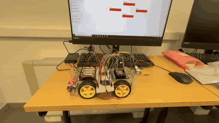
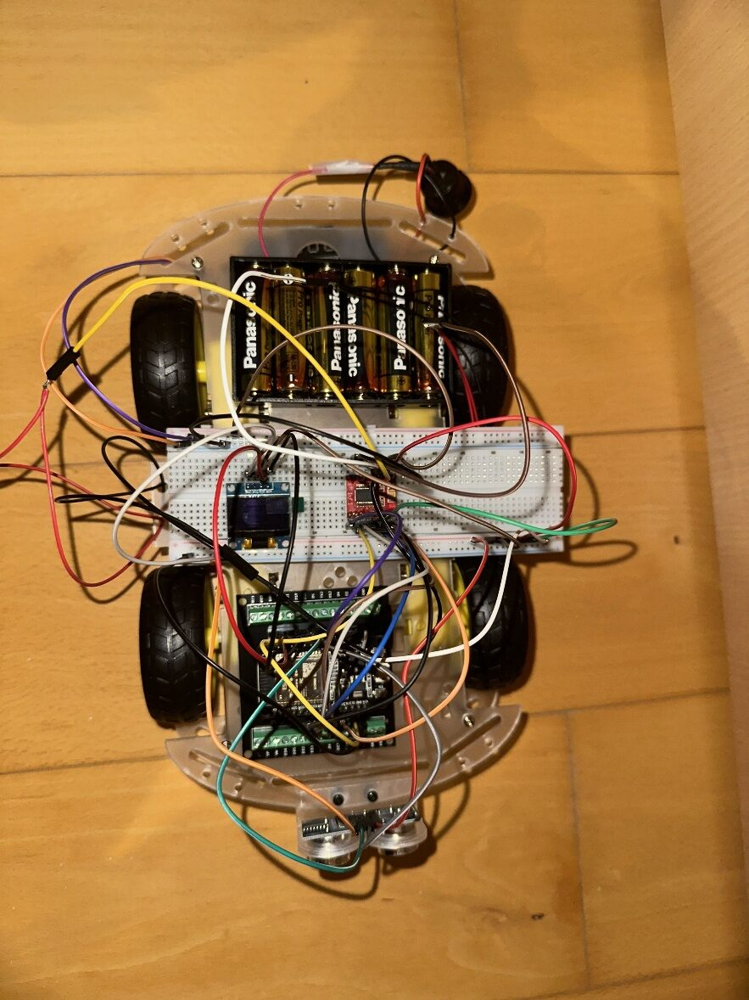
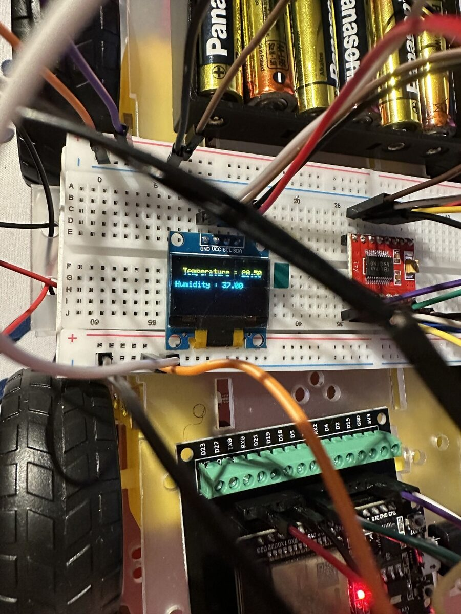
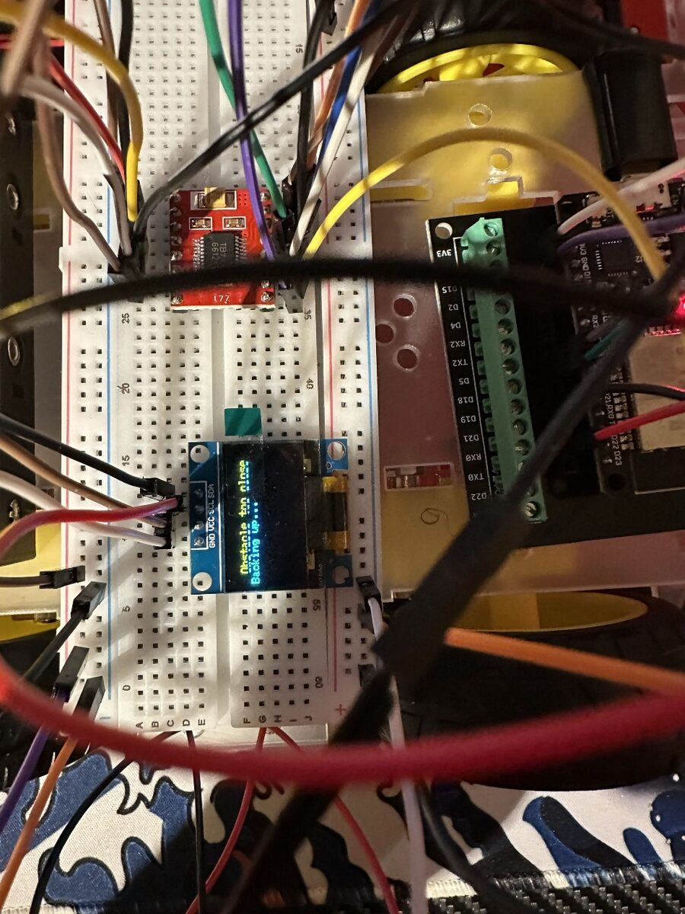
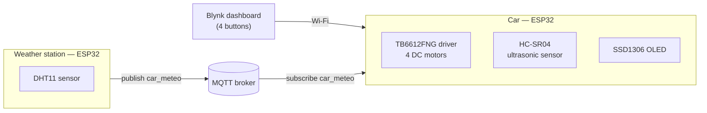
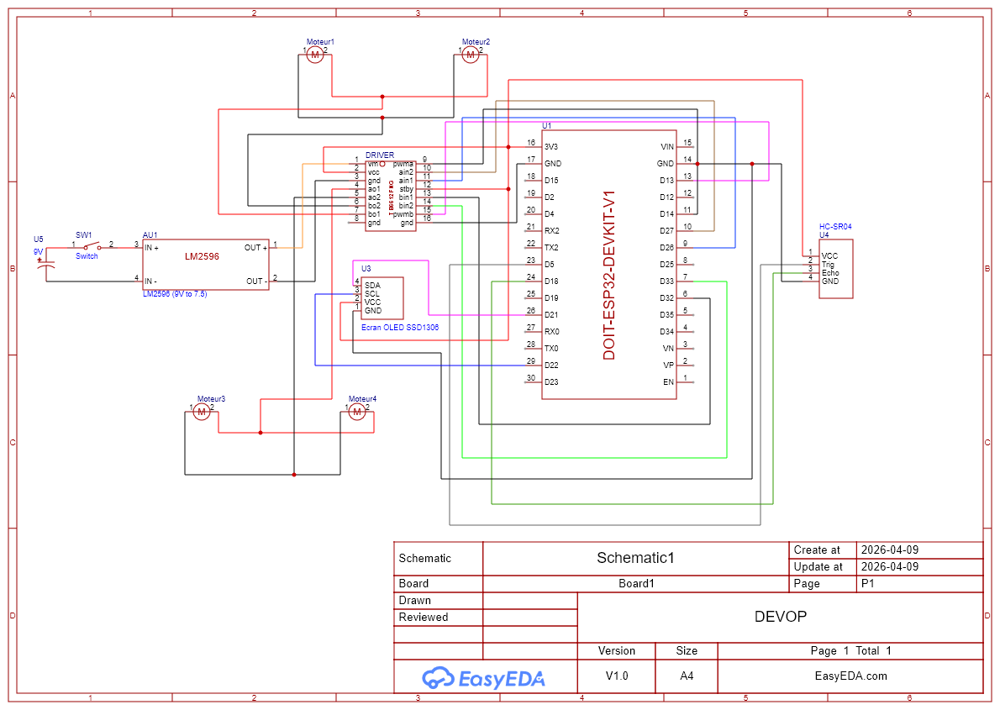
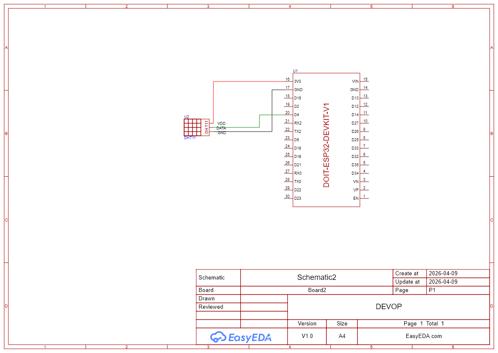

# 🚗 ESP32 IoT Car — Blynk Remote Control, Obstacle Detection & MQTT Weather Display


A four-wheel robot car built around an **ESP32**, driven remotely from a **Blynk** dashboard. An ultrasonic sensor makes the car back up automatically when an obstacle gets too close, and an OLED "dashboard" shows the temperature and humidity measured by a second ESP32 and published through an **MQTT** broker.

The project covered the whole chain: choosing the components, soldering and wiring the hardware, and programming both microcontrollers.

---

## 📽️ Demonstration

<p align="center">
  
</p>

<p align="center">
  
  
  
</p>

---

## ✨ Features

* **Remote control from Blynk:** four buttons (forward, backward, left, right) mapped to virtual pins `V0`–`V3`. The car moves while a button is held and stops when it is released.
* **PWM speed control:** the four DC motors are grouped by side (left / right) and driven through a TB6612FNG motor driver with 8-bit PWM.
* **Turning:** several strategies were tested (one side only, sides in opposite directions, one side faster than the other). The last one was kept, as it gave the smoothest turns.
* **Obstacle detection:** an HC-SR04 ultrasonic sensor at the front makes the car back up automatically and displays a warning on the OLED screen.
* **Weather display over MQTT:** a second ESP32 reads a DHT11 sensor and publishes the temperature and humidity every second; the car subscribes to the same topic and shows the values on its OLED screen.

---

## 🏗️ System Overview



---

## 🔌 Hardware

| Component | Role |
| :--- | :--- |
| ESP32 (DOIT DevKit V1) ×2 | Car controller / weather station |
| Chassis with 4 DC motors and wheels | Car body |
| TB6612FNG | Motor driver (2 channels, one per side) |
| 6×AA battery holder (9 V) + rocker switch | Motor power supply |
| LM2596 step-down converter | Lowers 9 V to 7.5 V for the driver |
| USB power bank | ESP32 power supply |
| HC-SR04 | Ultrasonic distance sensor |
| SSD1306 OLED 128×64 (I²C) | On-board display |
| DHT11 | Temperature and humidity sensor |

### Pin Mapping (car)

| Function | ESP32 pin |
| :--- | :--- |
| Right motors IN1 / IN2 / PWM | 27 / 26 / 14 |
| Left motors IN1 / IN2 / PWM | 33 / 32 / 13 |
| HC-SR04 Trig / Echo | 5 / 18 |
| OLED SDA / SCL | 21 / 22 |

Weather station: DHT11 data pin on GPIO 4.

### Wiring Diagrams

<details>
<summary><strong>🔍 Car wiring</strong></summary>



</details>

<details>
<summary><strong>🔍 Weather station wiring</strong></summary>



</details>

---

## 📂 Repository Structure

```text
esp32-iot-car/
├── car_control_blynk_oled_mqtt/
│   └── car_control_blynk_oled_mqtt.ino   # Car: Blynk control, motors, ultrasonic sensor, OLED, MQTT subscriber
├── dht11_esp32_to_mqtt/
│   └── dht11_esp32_to_mqtt.ino           # Weather station: DHT11 readings published to MQTT
└── docs/                                  # Wiring diagrams, photos and demo GIF
```

---

## 🔧 Hardware Iterations

* **Motor driver:** the first driver (L298N) caused a voltage drop of about 2 V, which reduced the motor torque so much that the car could not move. I replaced it with a **TB6612FNG** and increased the supply from 6 V to 9 V.
* **Power supply:** the LM2596 converter was first used to power the ESP32. After switching driver, I used it to bring the driver's input down to **7.5 V**, within the motors' optimal range (6–8 V), and moved the ESP32 to a USB power bank.

---

## 🧠 Retrospective & Possible Improvements

* **Power:** the USB power bank is too heavy to sit on the car and has to be held during use. A second step-down converter (9 V → 5 V) in parallel would make the car fully autonomous.
* **Non-blocking obstacle handling:** while the car backs away from an obstacle, the loop does not call `Blynk.run()`, so the remote control is unresponsive during that time. A non-blocking state machine based on `millis()` would fix this.
* **Connection resilience:** the MQTT connection is only established in `setup()`; adding a reconnection routine in `loop()` would handle network drops.
* **Security:** the project uses a public MQTT broker without TLS, so anyone can read or publish on the topic. That was acceptable for a classroom prototype, but a real deployment would need a private broker, authentication per device and encrypted connections (MQTT over TLS, port 8883).
* **Sensor robustness:** DHT11 readings can fail and return `NaN`; they should be checked before being published.

---

## 👤 Author & Context

* **Aymen JERIDI** — individual project for an optional course on connected objects (*Développement d'objets connectés — IoT*), taken alongside my Bachelor in Applied Computer Science (Application Development) at EPFC, Brussels (2026).

> **⚠️ Academic Notice:** This project is a learning prototype built for coursework and portfolio purposes. It is not intended for production use.
